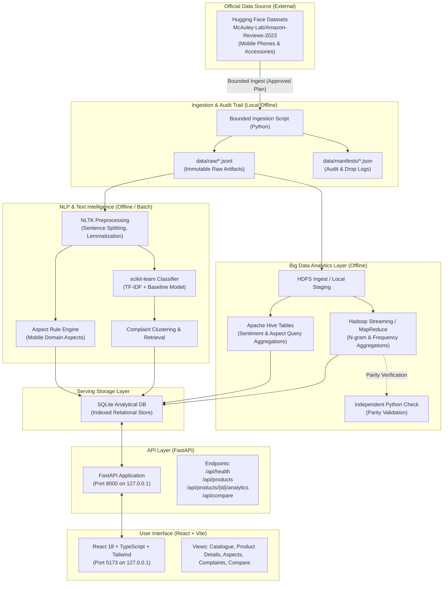

# ProductPulse — Architecture & System Design (`ARCHITECTURE.md`)

> **PERMANENT CATEGORY LOCK NOTICE**  
> Authorized Category: **Mobile Phones & Accessories**  
> Permitted Source Dataset: **McAuley-Lab/Amazon-Reviews-2023** (Hugging Face)  
> No architecture component may accept or process data outside this strict domain.

---

## 1. System Overview

ProductPulse separates offline Big Data processing, NLP modeling, relational analytical serving, and reactive user interfaces into clean, decoupled layers.



---

## 2. Component Responsibilities

### 2.1 Ingestion & Manifest Subsystem (`scripts/`, `data/`)
- Connects to Hugging Face via official, approved methods.
- Enforces strict bounding rules (e.g., maximum 500 reviews in initial sample).
- Validates category tags against the *Mobile Phones & Accessories* domain.
- Writes raw, immutable JSONL records to `data/raw/`.
- Generates execution manifests with SHA-256 checksums, admission counts, and drop justifications in `data/manifests/`.

### 2.2 Big Data Analytics (BDA) Subsystem (`bda/`)
- Executes distributed batch aggregation jobs on Hadoop / HDFS and Hive.
- **MapReduce / Streaming**: Computes word frequencies, bigram co-occurrences, and review counts per product.
- **Apache Hive**: Creates external/managed tables over review data, executing structured SQL queries for average ratings, verified purchase ratios, and aspect sentiment distributions.
- **Reference Parity Engine**: Calculates identical metrics in pure Python to independently confirm Hadoop/Hive mathematical outputs before inserting them into SQLite.
- *Status Note*: The `hadoop` and `hive` commands were not found in the checked Windows PATH or WSL Ubuntu PATH, and the host has Java 24.0.1. Compatibility must be established for the specific Hadoop/Hive versions selected using authoritative documentation prior to Phase 9. An approved execution environment (e.g., a lightweight Docker container or WSL environment) will be evaluated and proposed in Phase 9.

### 2.3 NLP Intelligence Subsystem (`nlp/`)
- **Preprocessing**: Sentence boundary detection, tokenization, POS tagging, and stopword removal using NLTK.
- **Aspect Extraction**: Maps sentences to Mobile Phone aspects (*Battery, Camera, Display, Performance, Build Quality, Connectivity, Charging, Software/OS*) using curated rule dictionaries and noun-phrase parsing.
- **Sentiment Classification**: Trains and evaluates an interpretable baseline model (TF-IDF + Logistic Regression / Linear SVM) using scikit-learn.
- **Complaint Discovery**: Groups negative sentiment snippets by aspect, discovers high-frequency complaint phrases, and retrieves authentic quote evidence for user verification.

### 2.4 Analytical Serving Subsystem (`backend/db/`)
- Single local SQLite database (`productpulse.db`) acting as the high-speed read cache.
- Houses normalized tables: `products`, `reviews`, `sentiment_predictions`, `aspect_evidence`, `complaint_clusters`, and pre-aggregated `product_analytics_summary`.
- Utilizes parameterized queries and indexes on `product_id`, `aspect_name`, and `review_date`.

### 2.5 Backend API (`backend/`)
- Built with Python 3.12, FastAPI, and Pydantic.
- Exposes typed REST endpoints bound strictly to `127.0.0.1:8000`.
- Implements pagination, sorting, search filters, and standard HTTP error codes (404, 422).
- Restricted CORS policy permitting only `http://localhost:5173`.

### 2.6 Frontend Interface (`frontend/`)
- Single-page application built with React 18, TypeScript, Vite, and Tailwind CSS.
- Bound strictly to `http://localhost:5173`.
- Delivers an original ProductPulse identity without proprietary e-commerce branding.
- Features:
  - Catalogue browsing with dynamic filters (price, rating, brand).
  - Deep-dive product detail page with aspect breakdown and clickable complaint evidence.
  - Head-to-head comparison table for two selected products.
  - Historical sentiment trends (only rendered when timestamps and minimum sample thresholds $N \ge 10$ are satisfied).
  - Explicit loading skeletons, empty states, and error alerts.

---

## 3. Proposed Folder Structure

```
d:\ProductPulse-nlp-bda\
├── docs\                     # Project specifications, contracts, architectural guides
│   ├── PROJECT_SPEC.md
│   ├── PHASE_STATUS.md
│   ├── DATA_CONTRACT.md
│   ├── ARCHITECTURE.md
│   └── ENVIRONMENT_REPORT.md
├── data\                     # Data artifacts (Git-ignored)
│   ├── raw\                  # Untouched downloaded JSONL extracts
│   ├── processed\            # Normalized and cleaned datasets
│   ├── manifests\            # Audit trails, drop logs, ingestion manifests
│   └── reports\              # Quality and evaluation reports
├── nlp\                      # Natural Language Processing modules
│   ├── preprocessing.py      # NLTK tokenization and sentence segmenter
│   ├── aspect_extractor.py   # Category-specific aspect detection rules
│   ├── sentiment_model.py    # scikit-learn training and inference
│   └── complaint_miner.py    # Complaint clustering and evidence linker
├── bda\                      # Big Data Analytics jobs
│   ├── hadoop\               # Mapper and Reducer scripts (Python streaming)
│   ├── hive\                 # HiveQL DDL and analytical aggregation queries
│   └── validation\           # Independent reference calculation scripts
├── backend\                  # FastAPI application
│   ├── app\
│   │   ├── main.py           # FastAPI entrypoint, middleware, CORS
│   │   ├── config.py         # App configuration and environment settings
│   │   ├── models\           # SQLAlchemy ORM models
│   │   ├── schemas\          # Pydantic request/response schemas
│   │   ├── routers\          # API route handlers
│   │   └── services\         # Analytical query execution logic
│   └── requirements.txt      # Backend Python dependencies
├── frontend\                 # React + TypeScript SPA
│   ├── src\
│   │   ├── components\       # UI widgets, layout, cards, charts
│   │   ├── pages\            # Catalogue, ProductDetails, Compare
│   │   ├── services\         # Axios / fetch API clients
│   │   ├── types\            # TypeScript API response contracts
│   │   └── App.tsx
│   ├── package.json
│   ├── vite.config.ts
│   └── tailwind.config.js
├── tests\                    # Automated testing suite
│   ├── unit\                 # Unit tests for transformations and NLP
│   ├── integration\          # API and database tests
│   └── e2e\                  # End-to-end verification tests
└── scripts\                  # Administrative and ingestion automation
    ├── verify_env.py         # Environment verification script
    └── ingest_sample.py      # Bounded data ingestion utility
```

> *Note*: In Phase 0, this structure is a proposal only. No empty folders or source code files are created until their authorized phase.

---

## 4. Planned Backend API Endpoints

| Endpoint | Method | Role & Description | Phase |
| :--- | :---: | :--- | :---: |
| `/api/health` | GET | Liveness probe and database connection status. | 4 |
| `/api/catalog/filters` | GET | Distinct brands, price ranges, and category tags. | 4 |
| `/api/products` | GET | Paginated, filtered, and sorted product list. | 4 |
| `/api/products/{id}` | GET | Single product details with verified image references. | 4 |
| `/api/products/{id}/reviews` | GET | Paginated authentic reviews for a product. | 4 |
| `/api/products/{id}/analytics` | GET | Sentiment percentages, aspect breakdowns, and counts. | 7 |
| `/api/products/{id}/complaints`| GET | Discovered negative themes with linked review snippets. | 8 |
| `/api/products/{id}/trends` | GET | Historical monthly sentiment and volume series. | 10 |
| `/api/compare` | GET | Side-by-side metric comparison of two product IDs. | 10 |
| `/api/processing/status` | GET | Ingestion manifests, model versions, and run metrics. | 4 |

---

## 5. Architectural Decisions Pending Phase 1 & Later Phases

1. **Category Hierarchy Verification**:
   - Whether *Mobile Phones & Accessories* exists as a dedicated top-level split in `McAuley-Lab/Amazon-Reviews-2023` or requires filtering within an `Electronics` split. (Pending Phase 1).
2. **BDA Execution Runtime**:
   - Host lacks Hadoop/Hive. Options: Docker container running single-node Hadoop/Hive, or WSL Ubuntu package setup. (Decision pending Phase 9 proposal).
3. **Review ID Resolution**:
   - Confirming whether Hugging Face records supply a persistent `review_id` or require the deterministic hashing algorithm defined in `DATA_CONTRACT.md`. (Pending Phase 1).
4. **Port Allocation Resolution**:
   - Ports 5173 and 8000 are currently occupied by external processes. Resolution requires user decision prior to Phase 4 / Phase 5.
