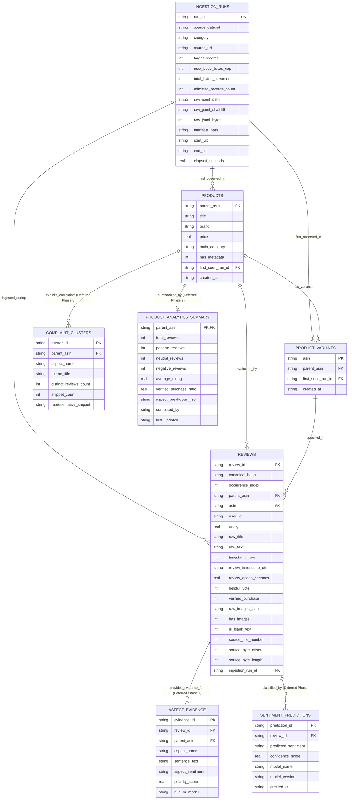

# ProductPulse — Phase 3: Data Contract Freeze & Database Design Proposal (Final Consistency Revision)

**Document Status:** FINAL PROPOSAL / FOR REVIEW ONLY (Inspection, Design & Documentation)  
**Target Environment:** SQLite (Application Serving Layer) & Downstream Big Data (Hive/MapReduce)  
**Target Category Lock:** `Cell_Phones_and_Accessories` (Mobile Phones & Accessories Only)  
**Source Dataset:** `McAuley-Lab/Amazon-Reviews-2023` (Official Hugging Face Repository)  
**Sample Reference:** `data/raw/sample_reviews_cell_phones_25k.jsonl` (SHA-256: `86eca6adea79bb125fb373bde6a1d5b0e8027211754ba229b171e6d42f5e495a`, 25,000 records)  
**Manifest Reference:** `data/manifests/ingestion_manifest_phase2.json`  

---

## 1. Discrepancy Analysis & Reconciliation

The initial Phase 0 specifications (`DATA_CONTRACT.md`, `ARCHITECTURE.md`) have been systematically compared against the empirical findings from Phase 2C (`sample_reviews_cell_phones_25k.jsonl`, `ingestion_manifest_phase2.json`, and `scripts/ingest_sample.py`).

| Field / Topic | Phase 0 Provisional Assumption | Phase 2C Empirical Reality | Reconciliation & Resolution |
| :--- | :--- | :--- | :--- |
| **`parent_asin` vs `asin`** | Assumed `parent_asin` was nullable (`Nullable: YES`); treated `asin` as the primary product key. | `parent_asin` is present in **100.0%** of records (19,065 unique values). `asin` represents specific variant SKUs (20,484 unique values). | **Reconciled**: Treat `parent_asin` as the primary grouping entity (`products` table) and `asin` as the SKU variant (`product_variants` table). |
| **Review Body (`text`) Nullability** | Stated `text` "Must not be empty. Nullable: NO". | **7 records** (0.028%) contain blank or whitespace-only text (title-only ratings). | **Reconciled**: Allow `raw_text` to be empty string `""`; enforce that if present, it is of type string. Flag with `is_blank_text = 1`. In NLP pipelines, concatenate `title` with `text` to prevent division-by-zero token counts. Never drop genuine records. |
| **Duplicate Handling Strategy** | Proposed dropping duplicate `(product_id, user_id, timestamp)` tuples, keeping only the first. | User and audit requirements mandate preserving 100% of authentic source data. Script preserved 5 duplicates. | **Reconciled**: Ingest all duplicate records. Assign deterministic primary keys using canonical JSON hashing with occurrence ordinals (`<hash>`, `<hash>_#1`). |
| **Review Images & Redundancy** | Phase 0 only documented product-level metadata images (`product_images`). | Raw reviews contain customer-uploaded image arrays (`images`: `[{"small_image_url": ..., ...}]`). | **Reconciled**: Store verbatim raw image JSON in `reviews.raw_images_json`. Normalizing into a separate `review_images` table in SQLite is redundant for the initial review browser and is deferred. |
| **Product Metadata Presence** | Phase 0 schema assumed brand, title, and price metadata would be present immediately. | Metadata JSONL (~4.02 GB) has not yet been ingested. Reviews only provide `parent_asin` and `asin`. | **Reconciled**: Design `products` to operate without metadata initially. Products are identified by their authentic `parent_asin` with a `[Metadata Pending]` badge. Metadata columns allow future idempotent upsert. |
| **Timestamp Precision** | Provisional range 1998–2024; unit unverified. | 100% of timestamps are Unix epoch **milliseconds** (12–13 digits), ranging from `2003-05-13` to `2023-03-17`. | **Reconciled**: Retain raw integer millisecond timestamp in `timestamp_raw`, and store normalized UTC ISO-8601 string **with millisecond precision** (`YYYY-MM-DDTHH:MM:SS.sssZ`) in `review_timestamp_utc`. |

---

## 2. Canonical Data Contract Specification

This specification governs all records moving from raw JSONL storage into the SQLite serving layer and downstream Big Data batch jobs.

### 2.1 Upstream Review Source Fields (Immutable)

| Source Field | Canonical Field | Target SQL Type | Status | Nullable? | Validation Rules | Transformation / Normalization | Retain Source? | Intended Downstream Use |
| :--- | :--- | :--- | :--- | :---: | :--- | :--- | :---: | :--- |
| `parent_asin` | `parent_asin` | `TEXT` | Required | NO | Non-empty alphanumeric string, length $\le 20$. | Trim whitespace. | YES | Grouping reviews to catalog products; foreign key to `products`. |
| `asin` | `asin` | `TEXT` | Required | NO | Non-empty alphanumeric string, length $\le 20$. | Trim whitespace. | YES | Variant SKU identification; foreign key to `product_variants`. |
| `user_id` | `user_id` | `TEXT` | Required | NO | Non-empty anonymized string (e.g. `AFKZ...`). | Trim whitespace. | YES | Reviewer deduplication, user review count analysis, reviewer bias checks. |
| `rating` | `rating` | `REAL` | Required | NO | Floating point $1.0 \le r \le 5.0$. | Cast to float rounded to 1 decimal place. | YES | Source-provided reviewer star rating; benchmark for Hive/Hadoop average rating aggregations. *Not ground-truth aspect sentiment.* |
| `title` | `raw_title` | `TEXT` | Optional | YES | String if present. | Strip null bytes; preserve emojis and special characters. | YES | Review summary display; NLP headline aspect extraction. |
| `text` | `raw_text` | `TEXT` | Optional | YES | String if present; can be empty string `""`. | Strip null bytes; preserve formatting and casing. | YES | NLTK tokenization, TF-IDF feature extraction, aspect mining, complaint clustering. |
| `timestamp` | `timestamp_raw` | `INTEGER` | Required | NO | Integer Unix epoch milliseconds ($788918400000 \le t \le 2051222400000$). | Preserved as exact raw integer milliseconds. | YES | Historical time-series trend analysis (monthly/quarterly buckets); audit trail. |
| `helpful_vote` | `helpful_vote` | `INTEGER` | Required | NO | Non-negative integer ($\ge 0$). | Default to `0` if null or missing. | YES | Weighting review credibility; sorting reviews by helpfulness. |
| `verified_purchase`| `verified_purchase` | `INTEGER` | Required | NO | Boolean `true`/`false`. | Normalise to SQLite integer boolean (`1` or `0`). | YES | Verified vs unverified purchase sentiment divergence; Hive aggregations. |
| `images` | `raw_images_json` | `TEXT` | Optional | YES | JSON array of image objects with URLs. | Serialize valid JSON array to text string; store `'[]'` if empty. | YES | Customer gallery display, visual review evidence in UI. |

---

### 2.2 ProductPulse-Generated Provenance & Derived Fields

These fields are computed deterministically during ingestion or database loading. They are **never** represented as upstream source fields.

| Derived Field | Target SQL Type | Nullable? | Derivation Formula & Logic | Intended Purpose |
| :--- | :--- | :---: | :--- | :--- |
| `review_id` | `TEXT` | NO | `canonical_hash` for 1st occurrence (`occurrence_index == 0`); `<canonical_hash>_#<occurrence_index>` for duplicate occurrences ($occurrence\_index \ge 1$). | **Primary Key** for `reviews` table. Guarantees global uniqueness while retaining duplicates. |
| `canonical_hash` | `TEXT` | NO | `SHA256(json.dumps(raw_record, sort_keys=True, separators=(',', ':'), ensure_ascii=False))` | Exact cryptographic signature of source content for duplicate grouping. |
| `occurrence_index` | `INTEGER` | NO | `0` for original record, `1` for first duplicate, `2` for second, etc., tracked in sequential line order. | Explicit duplicate auditability. Querying `occurrence_index = 0` yields unique reviews. |
| `source_line_number` | `INTEGER` | NO | 1-based line number in `sample_reviews_cell_phones_25k.jsonl`. | Direct physical traceability back to raw JSONL file. |
| `source_byte_offset` | `INTEGER` | NO | Byte offset from start of raw JSONL file where record begins. | Zero-overhead direct file seek verification. |
| `source_byte_length` | `INTEGER` | NO | Byte length of the unparsed JSONL line including newline. | File pointer boundary verification. |
| `review_timestamp_utc` | `TEXT` | NO | Full-precision ISO-8601 UTC string: `YYYY-MM-DDTHH:MM:SS.sssZ` (preserves milliseconds). | Human-readable querying, sorting, and monthly temporal aggregation. |
| `review_epoch_seconds` | `REAL` | NO | `timestamp_raw / 1000.0` (floating point seconds with millisecond decimals). | High-speed range queries and numerical date calculations. |
| `is_blank_text` | `INTEGER` | NO | `1` if `length(trim(raw_text)) == 0`, else `0`. | Filters reviews that can only contribute rating/title to NLP pipelines. |
| `has_images` | `INTEGER` | NO | `1` if `raw_images_json != '[]'`, else `0`. | UI badge filter for reviews with customer photos. |
| `ingestion_run_id` | `TEXT` | NO | Foreign key referencing `ingestion_runs.run_id`. | Traceability to specific execution manifest and file checksum. |

---

## 3. Review Identifier & Duplicate Tracking Architecture

### 3.1 Trace of Review-ID Logic in `scripts/ingest_sample.py`
In `scripts/ingest_sample.py` lines 88–94 and 218–234:
1. `compute_canonical_review_id(record)` generates the SHA-256 digest over the canonical JSON representation:
   ```python
   canonical_json_str = json.dumps(record, sort_keys=True, separators=(",", ":"), ensure_ascii=False)
   canonical_hash = hashlib.sha256(canonical_json_str.encode("utf-8")).hexdigest()
   ```
2. A dictionary `self._hash_counts: Dict[str, int]` tracks occurrences encountered in sequential line order:
   ```python
   occurrence_idx = self._hash_counts.get(canonical_hash, 0)
   self._hash_counts[canonical_hash] = occurrence_idx + 1

   if occurrence_idx == 0:
       review_id = canonical_hash
   else:
       review_id = f"{canonical_hash}_#{occurrence_idx}"
   ```
3. **First Occurrence**: `occurrence_index = 0` $\rightarrow$ `review_id = <canonical_hash>`.
4. **Subsequent Occurrences**: `occurrence_index = 1` $\rightarrow$ `review_id = <canonical_hash>_#1`.

### 3.2 Determinism Across Ingestion and Future Database Loading
- In `data/raw/sample_reviews_cell_phones_25k.jsonl`, all 25,000 lines are stored as immutable, complete JSON objects in deterministic sequence (lines 1 to 25,000).
- The future Phase 4 SQLite loader (`scripts/load_sample_to_sqlite.py`) will process lines sequentially from 1 to 25,000 using this identical hashing and counting algorithm.
- Because input ordering and content are immutable, the computed `canonical_hash`, `occurrence_index`, and `review_id` are **100% deterministic and identical across repeated runs**.

---

## 4. Product, Variant & Review Relationship Integrity

### 4.1 Hierarchy, Composite Foreign Keys & Cardinality
To ensure strict referential integrity between products, variants, and reviews:
1. **Products (`products`)**: Keyed by `parent_asin` (`PRIMARY KEY`). Represents the canonical catalog product entity.
2. **Variants (`product_variants`)**: Keyed by `asin` (`PRIMARY KEY`), linked to `parent_asin` via `FOREIGN KEY (parent_asin) REFERENCES products(parent_asin) ON DELETE CASCADE`.
   - In addition, an explicit `UNIQUE (asin, parent_asin)` constraint is placed on `product_variants`.
3. **Reviews (`reviews`)**: Keyed by `review_id` (`PRIMARY KEY`). Linked to variants and products via:
   - **Composite Foreign Key**:
     ```sql
     FOREIGN KEY (asin, parent_asin) 
     REFERENCES product_variants(asin, parent_asin) 
     ON DELETE RESTRICT
     ```
   - **Direct Product Foreign Key**:
     ```sql
     FOREIGN KEY (parent_asin) 
     REFERENCES products(parent_asin) 
     ON DELETE RESTRICT
     ```

### 4.2 Rationale for Composite Foreign Key & Direct Product Foreign Key
- **Why Composite FK `reviews(asin, parent_asin) -> product_variants(asin, parent_asin)` is Necessary**:
  If `reviews` only had two independent foreign keys (`reviews.asin -> product_variants.asin` and `reviews.parent_asin -> products.parent_asin`), SQLite would permit an invalid review where `asin = 'A1'` (belonging to parent `P1`) is paired with `parent_asin = 'P2'`. Both individual keys exist in their target tables, so independent FKs would pass.
  The **composite foreign key** strictly enforces that the review's `(asin, parent_asin)` pair must exist together in `product_variants`. Mismatched variant-to-parent pairings are rejected at the database level.
- **Why Keep Direct FK `reviews(parent_asin) -> products(parent_asin)`**:
  While the composite FK transitively guarantees that `parent_asin` belongs to a valid product (via `product_variants`), keeping the direct FK provides:
  1. Explicit schema documentation that a review evaluates the catalog product entity.
  2. Defense-in-depth against potential future schema migrations.
  3. Direct indexed navigation from `products` to `reviews` without requiring joins across `product_variants`.

### 4.3 SQLite Foreign Key Enforcement Pragma
SQLite requires foreign keys to be explicitly enabled per connection. Every database connection in the future FastAPI backend (via SQLAlchemy event hook) and offline scripts must execute:
```sql
PRAGMA foreign_keys = ON;
```

### 4.4 Policy on Conflicting `asin` to `parent_asin` Mappings
- **Verified Sample Reality**: All **20,484 ASINs** in the 25k sample map to **exactly one** `parent_asin` (verified 0 conflicts).
- **Conflict Policy for General Ingestion**:
  If a record is read where `asin` already exists in `product_variants` but carries a **different** `parent_asin`:
  1. The loader must **not** silently overwrite `product_variants.parent_asin`.
  2. The loader must **not** silently reassign the variant to an unverified parent.
  3. The conflict is recorded in an import error log / manifest, and the transaction is aborted or the record quarantined.

---

## 5. Schema Classification: Initial vs. Deferred Tables

To prevent overengineering and keep the initial serving layer minimal, tables are divided into two distinct tiers:

### Tier 1: Core Initial Review-Browser Tables (Required for Phase 3/4)
These 4 tables are strictly required to serve product browsing, variant selection, review feeds, and audit verification.

1. **`ingestion_runs`**: Stores manifest transport evidence, SHA-256 checksums, byte counts, and timestamps.
2. **`products`**: Stores catalog products keyed by `parent_asin`. In Phase 3/4, operates without metadata (`title`, `brand`, `price` are NULL).
3. **`product_variants`**: Stores individual variant SKUs keyed by `asin`, linked to `parent_asin` with composite unique constraint.
4. **`reviews`**: Stores all 25,000 authentic customer reviews, ratings, full text, titles, millisecond timestamps, helpful votes, verified purchases, line/byte offsets, and raw image JSON.

### Tier 2: Deferred NLP & Analytics Tables (Phases 7, 8, 9)
These tables are fully designed here but will **not** be created in SQLite until their respective phases are reached.

5. **`sentiment_predictions`** *(Deferred to Phase 7)*: Stores model-generated overall sentiment classifications (`positive`, `neutral`, `negative`) and confidence scores. Kept strictly separate from `reviews.rating`.
6. **`aspect_evidence`** *(Deferred to Phase 7)*: Stores extracted review sentences and granular aspect polarity scores.
7. **`complaint_clusters`** *(Deferred to Phase 8)*: Stores aggregated thematic clusters of customer complaints. Explicitly labeled as customer feedback, never as verified hardware defects.
8. **`product_analytics_summary`** *(Deferred to Phase 9)*: Stores pre-computed batch aggregations generated by Hadoop/Hive/MapReduce and verified against SQLite baselines.
9. **`review_images`** *(Deferred / Redundant for Initial Browser)*:
   - *Redundancy Analysis*: In the 25k sample, only 1,823 reviews have images (7.29%). The raw array is already stored in `reviews.raw_images_json`. Normalizing this into a separate table creates 1,823+ redundant rows with zero query benefit, since the web frontend fetches images as part of the review feed. Normalization is deferred unless specific cross-product image search is requested.

---

## 6. Entity-Relationship Architecture



---

## 7. Proposed SQLite Schema DDL (For Review Only)

### Tier 1: Core Initial Review-Browser DDL

```sql
-- ProductPulse Analytical Serving Database Schema (Tier 1 Core DDL Proposal)
-- Database Engine: SQLite 3.35+
-- Foreign Keys MUST be enabled: PRAGMA foreign_keys = ON;

PRAGMA foreign_keys = ON;

--------------------------------------------------------------------------------
-- 1. INGESTION RUNS (Audit & Provenance Table)
--------------------------------------------------------------------------------
CREATE TABLE IF NOT EXISTS ingestion_runs (
    run_id TEXT PRIMARY KEY,
    manifest_version TEXT NOT NULL DEFAULT '1.0',
    dataset_name TEXT NOT NULL,
    category TEXT NOT NULL,
    source_url TEXT NOT NULL,
    target_records INTEGER NOT NULL,
    max_body_bytes_cap INTEGER NOT NULL,
    cumulative_timeout_seconds REAL NOT NULL,
    final_status INTEGER NOT NULL,
    content_range TEXT NOT NULL,
    total_bytes_streamed INTEGER NOT NULL,
    admitted_records_count INTEGER NOT NULL,
    total_lines_processed INTEGER NOT NULL,
    trailing_incomplete_bytes INTEGER NOT NULL,
    parse_errors_count INTEGER NOT NULL,
    validation_errors_count INTEGER NOT NULL,
    duplicates_count INTEGER NOT NULL,
    unique_parent_asins_count INTEGER NOT NULL,
    unique_asins_count INTEGER NOT NULL,
    unique_users_count INTEGER NOT NULL,
    raw_jsonl_path TEXT NOT NULL,
    raw_jsonl_bytes INTEGER NOT NULL,
    raw_jsonl_sha256 TEXT NOT NULL,
    manifest_path TEXT NOT NULL,
    start_utc TEXT NOT NULL,
    end_utc TEXT NOT NULL,
    elapsed_seconds REAL NOT NULL,
    sampling_nature TEXT NOT NULL,
    population_claims_allowed INTEGER NOT NULL DEFAULT 0,
    created_at TEXT NOT NULL DEFAULT (strftime('%Y-%m-%dT%H:%M:%SZ', 'now'))
);

--------------------------------------------------------------------------------
-- 2. PRODUCTS (Parent ASIN Entity - Grouping Reviews)
--------------------------------------------------------------------------------
CREATE TABLE IF NOT EXISTS products (
    parent_asin TEXT PRIMARY KEY,
    title TEXT,                         -- NULL until metadata is ingested
    brand TEXT,                         -- NULL until metadata is ingested
    price REAL,                         -- NULL until metadata is ingested
    main_category TEXT DEFAULT 'Cell_Phones_and_Accessories',
    has_metadata INTEGER NOT NULL DEFAULT 0 CHECK (has_metadata IN (0, 1)),
    first_seen_run_id TEXT NOT NULL,
    created_at TEXT NOT NULL DEFAULT (strftime('%Y-%m-%dT%H:%M:%SZ', 'now')),
    FOREIGN KEY (first_seen_run_id) REFERENCES ingestion_runs(run_id) ON DELETE RESTRICT
);

--------------------------------------------------------------------------------
-- 3. PRODUCT VARIANTS (Specific SKU ASINs)
--------------------------------------------------------------------------------
CREATE TABLE IF NOT EXISTS product_variants (
    asin TEXT PRIMARY KEY,
    parent_asin TEXT NOT NULL,
    first_seen_run_id TEXT NOT NULL,
    created_at TEXT NOT NULL DEFAULT (strftime('%Y-%m-%dT%H:%M:%SZ', 'now')),
    FOREIGN KEY (parent_asin) REFERENCES products(parent_asin) ON DELETE CASCADE,
    FOREIGN KEY (first_seen_run_id) REFERENCES ingestion_runs(run_id) ON DELETE RESTRICT,
    UNIQUE (asin, parent_asin)          -- Target for composite foreign key from reviews
);

--------------------------------------------------------------------------------
-- 4. REVIEWS (Authentic Review Records & Provenance)
--------------------------------------------------------------------------------
CREATE TABLE IF NOT EXISTS reviews (
    review_id TEXT PRIMARY KEY,         -- Deterministic SHA256 or <hash>_#<N>
    canonical_hash TEXT NOT NULL,       -- Raw SHA256 of canonical JSON
    occurrence_index INTEGER NOT NULL DEFAULT 0,
    parent_asin TEXT NOT NULL,
    asin TEXT NOT NULL,
    user_id TEXT NOT NULL,
    rating REAL NOT NULL CHECK (rating >= 1.0 AND rating <= 5.0),
    raw_title TEXT,
    raw_text TEXT,
    timestamp_raw INTEGER NOT NULL,     -- Unix epoch milliseconds (exact source integer)
    review_timestamp_utc TEXT NOT NULL, -- Full-precision ISO-8601 UTC string (YYYY-MM-DDTHH:MM:SS.sssZ)
    review_epoch_seconds REAL NOT NULL, -- Unix epoch seconds with millisecond decimals
    helpful_vote INTEGER NOT NULL DEFAULT 0 CHECK (helpful_vote >= 0),
    verified_purchase INTEGER NOT NULL CHECK (verified_purchase IN (0, 1)),
    raw_images_json TEXT NOT NULL DEFAULT '[]',
    has_images INTEGER NOT NULL DEFAULT 0 CHECK (has_images IN (0, 1)),
    is_blank_text INTEGER NOT NULL DEFAULT 0 CHECK (is_blank_text IN (0, 1)),
    source_line_number INTEGER NOT NULL,
    source_byte_offset INTEGER NOT NULL,
    source_byte_length INTEGER NOT NULL,
    ingestion_run_id TEXT NOT NULL,
    created_at TEXT NOT NULL DEFAULT (strftime('%Y-%m-%dT%H:%M:%SZ', 'now')),
    -- Composite FK: Enforces that asin and parent_asin match the exact pair in product_variants
    FOREIGN KEY (asin, parent_asin) REFERENCES product_variants(asin, parent_asin) ON DELETE RESTRICT,
    -- Direct Product FK: Explicit defense-in-depth link to catalog products
    FOREIGN KEY (parent_asin) REFERENCES products(parent_asin) ON DELETE RESTRICT,
    FOREIGN KEY (ingestion_run_id) REFERENCES ingestion_runs(run_id) ON DELETE RESTRICT
);

--------------------------------------------------------------------------------
-- CORE INDEXES (Serving Query Optimization)
--------------------------------------------------------------------------------
-- Pattern 1: Product page review feed ordered by recency
CREATE INDEX IF NOT EXISTS idx_reviews_parent_asin_date 
ON reviews (parent_asin, review_epoch_seconds DESC);

-- Pattern 2: Filtering reviews by product and star rating
CREATE INDEX IF NOT EXISTS idx_reviews_parent_asin_rating 
ON reviews (parent_asin, rating);

-- Pattern 3: Variant lookup and filtering
CREATE INDEX IF NOT EXISTS idx_product_variants_parent 
ON product_variants (parent_asin);

-- Pattern 4: Reviewer history and deduplication auditing
CREATE INDEX IF NOT EXISTS idx_reviews_user_id 
ON reviews (user_id);

-- Pattern 5: Finding reviews with customer images
CREATE INDEX IF NOT EXISTS idx_reviews_has_images 
ON reviews (parent_asin, has_images) WHERE has_images = 1;
```

---

### Tier 2: Deferred NLP & Analytics DDL (For Reference in Later Phases)

```sql
--------------------------------------------------------------------------------
-- 5. SENTIMENT PREDICTIONS (Deferred to Phase 7: Model-Generated Outputs)
--------------------------------------------------------------------------------
CREATE TABLE IF NOT EXISTS sentiment_predictions (
    prediction_id TEXT PRIMARY KEY,
    review_id TEXT NOT NULL,
    predicted_sentiment TEXT NOT NULL CHECK (predicted_sentiment IN ('positive', 'neutral', 'negative')),
    confidence_score REAL NOT NULL CHECK (confidence_score >= 0.0 AND confidence_score <= 1.0),
    model_name TEXT NOT NULL,           -- e.g. 'tfidf_logistic_regression'
    model_version TEXT NOT NULL,        -- e.g. 'v1.0.0'
    created_at TEXT NOT NULL DEFAULT (strftime('%Y-%m-%dT%H:%M:%SZ', 'now')),
    FOREIGN KEY (review_id) REFERENCES reviews(review_id) ON DELETE CASCADE
);

--------------------------------------------------------------------------------
-- 6. ASPECT EVIDENCE (Deferred to Phase 7: Extracted Review Sentences)
--------------------------------------------------------------------------------
CREATE TABLE IF NOT EXISTS aspect_evidence (
    evidence_id TEXT PRIMARY KEY,
    review_id TEXT NOT NULL,
    parent_asin TEXT NOT NULL,
    aspect_name TEXT NOT NULL,          -- 'battery', 'camera', 'display', etc.
    sentence_text TEXT NOT NULL,
    aspect_sentiment TEXT NOT NULL CHECK (aspect_sentiment IN ('positive', 'neutral', 'negative')),
    polarity_score REAL,
    rule_or_model TEXT NOT NULL,
    created_at TEXT NOT NULL DEFAULT (strftime('%Y-%m-%dT%H:%M:%SZ', 'now')),
    FOREIGN KEY (review_id) REFERENCES reviews(review_id) ON DELETE CASCADE,
    FOREIGN KEY (parent_asin) REFERENCES products(parent_asin) ON DELETE CASCADE
);

--------------------------------------------------------------------------------
-- 7. COMPLAINT CLUSTERS (Deferred to Phase 8: Aggregated Recurring Customer Issues)
--------------------------------------------------------------------------------
CREATE TABLE IF NOT EXISTS complaint_clusters (
    cluster_id TEXT PRIMARY KEY,
    parent_asin TEXT NOT NULL,
    aspect_name TEXT NOT NULL,
    theme_title TEXT NOT NULL,
    distinct_reviews_count INTEGER NOT NULL CHECK (distinct_reviews_count >= 1),
    snippet_count INTEGER NOT NULL CHECK (snippet_count >= 1),
    representative_snippet TEXT NOT NULL,
    created_at TEXT NOT NULL DEFAULT (strftime('%Y-%m-%dT%H:%M:%SZ', 'now')),
    FOREIGN KEY (parent_asin) REFERENCES products(parent_asin) ON DELETE CASCADE
);

--------------------------------------------------------------------------------
-- 8. PRODUCT ANALYTICS SUMMARY (Deferred to Phase 9: Aggregated Serving Layer)
--------------------------------------------------------------------------------
CREATE TABLE IF NOT EXISTS product_analytics_summary (
    parent_asin TEXT PRIMARY KEY,
    total_reviews INTEGER NOT NULL DEFAULT 0,
    positive_reviews INTEGER NOT NULL DEFAULT 0,
    neutral_reviews INTEGER NOT NULL DEFAULT 0,
    negative_reviews INTEGER NOT NULL DEFAULT 0,
    average_rating REAL NOT NULL DEFAULT 0.0,
    verified_purchase_ratio REAL NOT NULL DEFAULT 0.0,
    aspect_breakdown_json TEXT NOT NULL DEFAULT '{}',
    computed_by TEXT NOT NULL,          -- 'SQLITE_BASELINE', 'HIVE_BATCH', 'MAPREDUCE'
    last_updated TEXT NOT NULL DEFAULT (strftime('%Y-%m-%dT%H:%M:%SZ', 'now')),
    FOREIGN KEY (parent_asin) REFERENCES products(parent_asin) ON DELETE CASCADE
);
```

---

## 8. Primary Keys, Foreign Keys & Index Rationale

### 8.1 Key Architecture Decisions
1. **`parent_asin` as Product PK**:
   Amazon reviews in this dataset group multiple SKU variations (colors, memory capacities) under one `parent_asin`. In the 25k sample, there are 19,065 `parent_asin` values spanning 20,484 `asin` values. Grouping by `parent_asin` prevents fragmented product cards where identical phone models have separate reviews.
2. **`asin` as Variant PK**:
   Enables tracking of specific SKUs while maintaining referential integrity to the parent.
3. **`review_id` with Occurrence Suffix**:
   The upstream source has 5 duplicate reviews. Hashing the canonical JSON yields identical keys. By appending `_#1`, `_#2` to duplicate occurrences, row identity is preserved without dropping records or breaking PK uniqueness.
4. **Strict Foreign Keys**:
   SQLite's `PRAGMA foreign_keys = ON;` must be enforced on every connection to ensure orphaned reviews or broken variant relations cannot be created.

### 8.2 Full-Text Search (FTS5) Evaluation
- **Standard B-Tree vs FTS5**: Standard `LIKE '%keyword%'` queries perform full table scans ($O(N)$), which is acceptable for $N=25,000$ in development, but scales poorly.
- **Recommendation**: Create an SQLite **FTS5 external content table** on `reviews(raw_title, raw_text)` during Phase 4/5:
  ```sql
  CREATE VIRTUAL TABLE IF NOT EXISTS reviews_fts USING fts5(
      raw_title,
      raw_text,
      content='reviews',
      content_rowid='rowid'
  );
  ```
  This provides sub-millisecond keyword searching without duplicating text storage on disk.

---

## 9. Import, Re-Import, Idempotency & Rollback Strategy

### 9.1 Separation of Ingestion vs. Database Loading
- **Existing Ingestion Script (`scripts/ingest_sample.py`)**:
  Responsible **exclusively** for network transport, bounded HTTP Range retrieval, streaming byte caps, and writing immutable JSONL (`data/raw/*.jsonl`) and manifest (`data/manifests/*.json`) files. It has **no** database awareness, executes no SQL, and manages no database state.
- **Future SQLite Loader (`scripts/load_sample_to_sqlite.py` - Future Phase 4 Specification)**:
  A separate script to be designed and implemented in Phase 4 that reads local raw JSONL and manifest files and populates SQLite.
  > [!IMPORTANT]
  > **Future Implementation Specification Notice**:
  > The database loader script (`scripts/load_sample_to_sqlite.py`) does **not** currently exist in the codebase, and no SQLite database file or tables have been created during Phase 3. The following rules constitute a binding design specification for its future Phase 4 implementation.

### 9.2 Future SQLite Loader Deterministic Identity & Idempotency Rules

#### 1. Deterministic Dataset and Run Identity
The loader must construct a deterministic `run_id` derived exclusively from immutable provenance attributes:
- **Source Category**: `manifest.dataset.category` (e.g., `'Cell_Phones_and_Accessories'`).
- **Raw Dataset SHA-256 Checksum**: Computed SHA-256 digest of the raw `.jsonl` payload on disk, validated against `manifest.output_files.raw_jsonl_sha256` (`86eca6adea79bb125fb373bde6a1d5b0e8027211754ba229b171e6d42f5e495a`).
- **Relevant Manifest Identity**: Manifest dataset name (`Amazon Reviews 2023 - Cell_Phones_and_Accessories`), manifest version (`1.0`), and canonical start timestamp (`manifest.execution.start_time_utc`).
- **Deterministic Identity Construction**:
  $$\text{run\_id} = \text{sha256}(\text{category} \parallel \text{":"} \parallel \text{raw\_jsonl\_sha256} \parallel \text{":"} \parallel \text{dataset\_name} \parallel \text{":"} \parallel \text{manifest\_version})[:16]$$
  *(or structured human-readable token: `run_Cell_Phones_86eca6ad_v1`)*.

This guarantees that repeating the loader against the identical raw file and manifest produces the exact same dataset/run identity every time.

#### 2. Strict No-Op (Idempotent Skip) Verification Requirements
A matching `run_id` and row count alone are strictly **insufficient** to declare an import a no-op.
Before declaring an import a no-op, the loader must query `ingestion_runs` and verify **all five** of the following conditions:
1. **Deterministic Run Identity**: The candidate `run_id` exists in `ingestion_runs(run_id)`.
2. **Stored Checksum**: `ingestion_runs.raw_jsonl_sha256` exactly matches the raw JSONL file's newly computed SHA-256 checksum on disk.
3. **Category Integrity**: `ingestion_runs.category` matches the expected category (`Cell_Phones_and_Accessories`).
4. **Dataset Identity**: `ingestion_runs.dataset_name` matches the manifest dataset identity (`Amazon Reviews 2023 - Cell_Phones_and_Accessories`).
5. **Expected Record Count & Table Reconciliation**:
   - `ingestion_runs.admitted_records_count` equals the expected record count from the manifest ($25,000$).
   - The actual count of loaded review rows linked to that run (`SELECT COUNT(*) FROM reviews WHERE ingestion_run_id = :run_id`) equals `ingestion_runs.admitted_records_count` ($25,000$).

Only when **all five** checks pass simultaneously may the loader declare the import an idempotent no-op:
- Cleanly report: `[IDEMPOTENT] Dataset identity, checksum, category, and record counts (25,000) verified in database. Zero modifications made.`
- Exit with code 0 without modifying any database tables or rows.

#### 3. Handling Identical vs. Differing Datasets
- **Identical Dataset**:
  When all no-op verification checks pass, the loader makes **no changes**. No duplicate rows are created, no timestamps are touched, and no transaction is committed.
- **Differing Dataset (No Silent Overwrites)**:
  If any element differs (different raw file checksum, different category, differing record count, or updated manifest identity):
  - **The loader must NEVER silently overwrite existing database records.**
  - **Default Policy (New Dataset Version)**: The differing checksum/identity deterministically produces a distinct `run_id`. The loader treats it as a new dataset version or partition, inserting the new run alongside existing data (with distinct provenance, run ID, and ingestion timestamps) without mutating previous records.
  - **Controlled Replacement Policy**: If the operator explicitly requests replacement of an existing dataset run (via an explicit CLI flag such as `--replace-run <target_run_id>`):
    1. The replacement must execute inside an immediate transaction: `BEGIN IMMEDIATE TRANSACTION;`.
    2. **Staging First**: The loader reads and fully validates 100% of the replacement records into memory or temporary staging tables first (verifying JSON structure, schema types, foreign key consistency, and zero duplicate PK collisions).
    3. **Deferred Deletion**: Only after the replacement dataset is completely validated are existing rows associated with `target_run_id` deleted and replaced within the active transaction.
    4. **Automatic Rollback**: If any validation, foreign key, or constraint check fails during replacement, `ROLLBACK TRANSACTION;` is executed immediately, leaving the prior dataset version completely unaltered and reporting the failure.

#### 4. Safe Entity Staging Order (Referential Integrity)
When performing a new import inside `BEGIN IMMEDIATE TRANSACTION;`, insertion follows strict dependency order to satisfy `PRAGMA foreign_keys = ON;`:
- **Step A (`ingestion_runs`)**: Insert the audit run record.
- **Step B (`products`)**: Extract distinct `parent_asin` values from the valid records and insert:
  ```sql
  INSERT OR IGNORE INTO products (parent_asin, first_seen_run_id) VALUES (?, ?);
  ```
- **Step C (`product_variants`)**: Extract distinct `(asin, parent_asin)` pairs and insert:
  ```sql
  INSERT OR IGNORE INTO product_variants (asin, parent_asin, first_seen_run_id) VALUES (?, ?, ?);
  ```
- **Step D (`reviews`)**: Insert all 25,000 review records.
- **Step E (Reconciliation Assertion & Rollback)**:
  Execute inside the uncommitted transaction:
  ```sql
  SELECT COUNT(*) FROM reviews WHERE ingestion_run_id = :run_id;
  ```
  If count $\ne 25,000$ or if any foreign key / constraint check fails:
  ```sql
  ROLLBACK TRANSACTION;
  ```
  Output failure reason and exit code 1.
- **Step F (Commit)**:
  Execute `COMMIT TRANSACTION;` only after all reconciliation assertions succeed.

---

## 10. Concrete Validation Queries Grounded in Actual Sample Data

Once imported during Phase 4 implementation, the following queries must produce these **exact numbers** corresponding to the Phase 2C data.

*(Note: These expected counts were verified directly against `data/raw/sample_reviews_cell_phones_25k.jsonl` using read-only Python streams; no SQL has yet been executed against any SQLite database).*

```sql
-- Test 1: Total review count must be exactly 25,000
SELECT COUNT(*) AS total_reviews FROM reviews;
-- EXPECTED: 25000 [VERIFIED]

-- Test 2: Distinct parent ASINs must be exactly 19,065
SELECT COUNT(DISTINCT parent_asin) AS distinct_parents FROM reviews;
-- EXPECTED: 19065 [VERIFIED]

-- Test 3: Products table count must match distinct parents
SELECT COUNT(*) AS total_products FROM products;
-- EXPECTED: 19065 [VERIFIED]

-- Test 4: Distinct ASINs must be exactly 20,484
SELECT COUNT(DISTINCT asin) AS distinct_asins FROM reviews;
-- EXPECTED: 20484 [VERIFIED]

-- Test 5: Distinct reviewers must be exactly 7,056
SELECT COUNT(DISTINCT user_id) AS distinct_users FROM reviews;
-- EXPECTED: 7056 [VERIFIED]

-- Test 6: Rating breakdown verification
SELECT rating, COUNT(*) AS count 
FROM reviews 
GROUP BY rating 
ORDER BY rating;
-- EXPECTED [VERIFIED]:
-- 1.0 -> 2367
-- 2.0 -> 1288
-- 3.0 -> 2000
-- 4.0 -> 3530
-- 5.0 -> 15815

-- Test 7: Duplicate occurrences verification (occurrence_index convention)
SELECT occurrence_index, COUNT(*) AS count 
FROM reviews 
GROUP BY occurrence_index 
ORDER BY occurrence_index;
-- EXPECTED [VERIFIED]:
-- 0 -> 24995 (Primary original instances)
-- 1 -> 5     (First duplicate occurrences)

-- Test 8: Verified purchases ratio
SELECT verified_purchase, COUNT(*) AS count 
FROM reviews 
GROUP BY verified_purchase;
-- EXPECTED [VERIFIED]:
-- 0 (False) -> 3644
-- 1 (True)  -> 21356

-- Test 9: Blank review text count
SELECT COUNT(*) AS blank_text_reviews 
FROM reviews 
WHERE is_blank_text = 1;
-- EXPECTED: 7 [VERIFIED]

-- Test 10: Reviews with customer-uploaded images
SELECT COUNT(*) AS reviews_with_images 
FROM reviews 
WHERE has_images = 1;
-- EXPECTED: 1823 [VERIFIED]

-- Test 11: Date range bounds verification (FULL MILLISECOND PRECISION)
SELECT 
    MIN(review_timestamp_utc) AS earliest_review,
    MAX(review_timestamp_utc) AS latest_review 
FROM reviews;
-- EXPECTED [VERIFIED]:
-- earliest_review: '2003-05-13T02:10:33.000Z' (timestamp_raw: 1052791833000)
-- latest_review:   '2023-03-17T01:23:01.765Z' (timestamp_raw: 1679016181765)

-- Test 12: ASIN-to-parent mapping uniqueness (No 1-to-many variant conflicts)
SELECT asin, COUNT(DISTINCT parent_asin) AS parent_count
FROM reviews
GROUP BY asin
HAVING parent_count > 1;
-- EXPECTED: 0 rows [VERIFIED]

-- Test 13: Referential integrity across composite key
SELECT COUNT(*) AS orphaned_reviews
FROM reviews r
LEFT JOIN product_variants pv 
  ON r.asin = pv.asin AND r.parent_asin = pv.parent_asin
WHERE pv.asin IS NULL;
-- EXPECTED: 0 rows [VERIFIED]
```

---

## 11. Risks, Assumptions & Unresolved Decisions

1. **Catalog Browsing Without Metadata**:
   - Products currently lack titles, brands, descriptions, and prices. The catalog browse view in Phase 5 will render authentic `parent_asin` values with a `[Metadata Pending]` tag. No synthetic names will be invented.
2. **Blank Review Text Handling**:
   - 7 reviews have empty text bodies. The NLP preprocessing pipeline must handle empty strings without zero-division errors by concatenating with `raw_title`.
3. **Sentiment Model Output vs Source Rating**:
   - Customer star ratings are empirical source facts. Predicted sentiment is a model inference. They remain strictly separated across tables.
4. **Complaint Evidence vs Product Defects**:
   - Complaints are empirical thematic groupings of negative user reviews. They are never reported as verified manufacturer defects.

---

## 12. Proposed File Updates for Implementation Phase

When Phase 3 implementation is formally authorized, the following files will be created or updated:

1. **`DATA_CONTRACT.md`**: Update with the finalized specifications from this proposal.
2. **`ARCHITECTURE.md`**: Update schema sections and table relationship descriptions.
3. **`PHASE_STATUS.md`**: Update Phase 2 to `complete`, Phase 3 to `in_progress`.
4. **`backend/db/schema.sql`**: Persist the approved Tier 1 DDL.
5. **`backend/db/session.py`**: Configure SQLite connection with `PRAGMA foreign_keys = ON;`.
6. **`scripts/load_sample_to_sqlite.py`**: Implement the transactional, idempotent loading script adhering to Section 9.2.
7. **`tests/test_sqlite_import.py`**: Automated unit tests executing the 13 validation queries against a temporary in-memory or test SQLite database.

---

## 13. Summary & Stop Condition

- **Inspection Conducted**: Read-only inspection across all project files, sample dataset, and manifests.
- **State Modifications**: Only [`PHASE_3_DATA_CONTRACT_PROPOSAL.md`](file:///D:/ProductPulse-nlp-bda/PHASE_3_DATA_CONTRACT_PROPOSAL.md) was updated.
- **Zero SQLite databases created or modified**.
- **Zero SQL statements executed**.
- Execution halted for user review. Ready for feedback before Phase 4.
