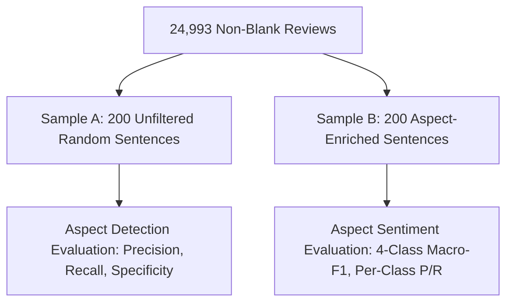
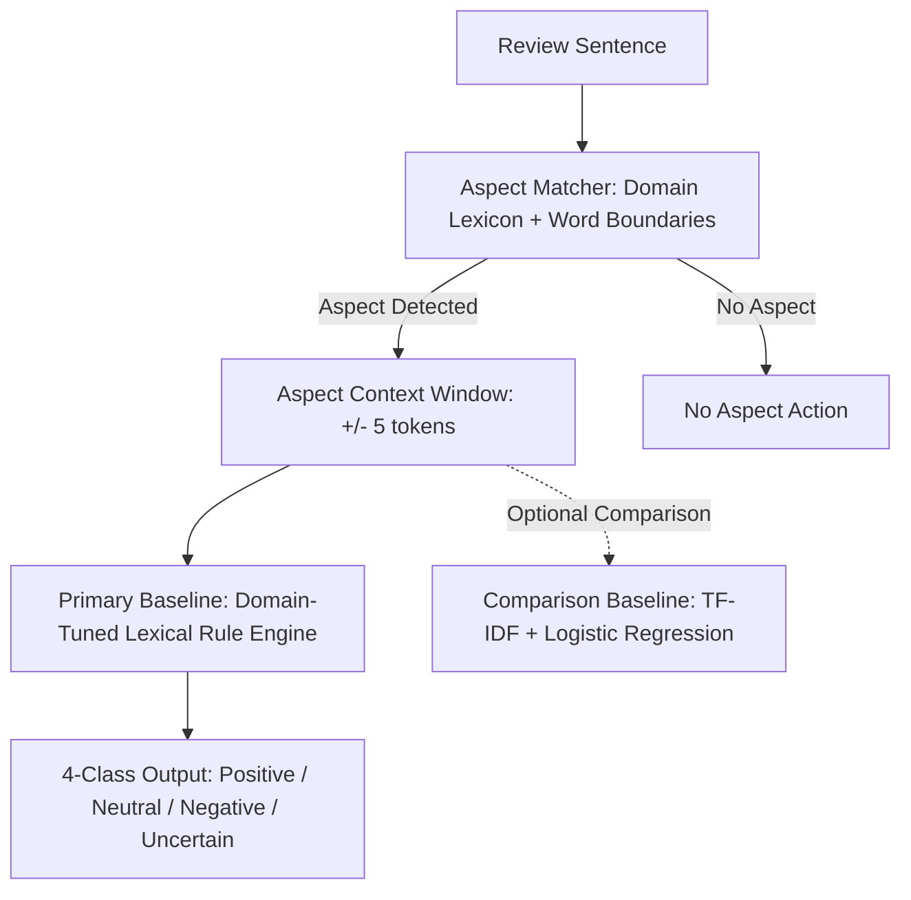

# ProductPulse — Phase 7 Design and Evaluation Proposal (Final Revision)
## Aspect-Based Sentiment Analysis (ABSA) for Mobile Phones & Accessories

> **STATUS: PROPOSAL ONLY — FOR USER REVIEW & APPROVAL**  
> **Workspace:** `D:\ProductPulse-nlp-bda`  
> **Target Domain Lock:** `Cell_Phones_and_Accessories` (Amazon Reviews 2023)  
> **Dataset Scope:** 25,000-review convenience prefix sample (`sample_reviews_cell_phones_25k.jsonl`, SHA-256 `86eca6adea79bb125fb373bde6a1d5b0e8027211754ba229b171e6d42f5e495a`)  
> **Strict Authorization Notice:** This document is a design and evaluation proposal only. Any code creation, pipeline execution, package installation (`nltk`, `scikit-learn`), lexical resource download, database schema migration, Tier 2 table creation, annotation file creation, model training, or prediction generation requires separate, explicit user approval.

---

## 1. Executive Summary & Objectives

ProductPulse provides transparent, empirical review intelligence across mobile phones and accessories (chargers, cases, screen protectors, cables, mounts, and audio equipment). In Phases 1 through 6, the core ingestion pipeline, SQLite serving database, FastAPI backend, and React/Tailwind frontend were built, audited, and verified against genuine customer reviews.

**Phase 7** designs **Aspect-Based Sentiment Analysis (ABSA)**. The goal is to extract explainable, verifiable insights into specific product dimensions (e.g., *battery life, screen display, camera quality, build durability, connectivity, and performance*) directly from customer text.

### Primary Objectives
1. **Aspect Detection**: Determine whether an authentic review sentence mentions one or more defined mobile hardware or accessory aspects using an explicit, explainable domain lexicon and boundary matching rules.
2. **Aspect Sentiment Classification**: Classify the polarity of each detected aspect mention into defined discrete outcomes: `positive`, `neutral`, `negative`, or `uncertain/unclassified` when evidence is ambiguous, mixed, or insufficient.
3. **Multi-Aspect Support**: Reliably evaluate sentences and reviews that mention multiple aspects with differing polarities (e.g., positive build quality but negative battery life).
4. **Traceable Review Evidence**: Every sentiment claim displayed in the UI or returned by the API must link directly to an authentic sentence quote and its source `review_id`, enabling end-to-end verification.
5. **Transparent, Local Execution**: Implement lightweight, explainable NLP baselines that execute entirely locally in `.venv` without external generative LLMs or paid cloud APIs.

### Explicit Non-Goals
- **No Generative LLMs or Paid APIs**: No reliance on OpenAI, Google Gemini API, Anthropic Claude, or any paid cloud service for run-time inference or batch processing.
- **No Star-Rating Equivalence**: A reviewer's overall star rating is **never** treated as ground-truth aspect sentiment.
- **No Population Generalization Claims**: The 25,000-record dataset is a prefix sample from Hugging Face, not a randomized or demographic cross-section of all Amazon buyers.
- **No Unsubstantiated Defect Claims**: A negative aspect mention reflects an empirical customer grievance, not verified legal or engineering proof of a product defect.
- **No Premature Ensembles**: Model stacking and complex ensemble pipelines are explicitly deferred to avoid unnecessary architectural overhead.
- **No Unvalidated Performance Claims**: Zero synthetic or speculative accuracy figures are reported prior to actual evaluation on annotated data.

---

## 2. Empirical Dataset Profile (Read-Only Evidence)

Read-only inspection of the active 25,000-review corpus (`data/raw/sample_reviews_cell_phones_25k.jsonl` and `backend/db/productpulse.db`) establishes the following factual baseline:

| Metric | Empirical Value | Architectural Implication |
| :--- | :--- | :--- |
| **Total Review Records** | 25,000 | Bounded prefix sample from `Cell_Phones_and_Accessories.jsonl`. |
| **Blank-Text Records** | 7 (0.03%) | Preserved in database with `is_blank_text = 1`. Handled by a deterministic bypass rule ("no text to analyze"). |
| **Duplicate Occurrence Records** | 5 (0.02%) | Preserved with `occurrence_index > 0`. Must be strictly quarantined with equivalent canonical records to prevent cross-partition leakage. |
| **Median Review Length** | 136 characters | Short-to-medium texts dominate; sentence tokenization must handle terse fragments. |
| **90th Percentile Length** | 594 characters | Long reviews require sentence segmentation to isolate multi-aspect opinions. |
| **Max Review Length** | 10,673 characters | Long-form reviews often express conflicting sentiments across different aspects. |
| **Star Rating Distribution** | 1★: 2,367 (9.47%)<br>2★: 1,288 (5.15%)<br>3★: 2,000 (8.00%)<br>4★: 3,530 (14.12%)<br>5★: 15,815 (63.26%) | **Severe positive class imbalance (77.38% 4–5★)**. Evaluation must use **Macro-averaged F1** and per-class metrics rather than raw accuracy. |

---

## 3. Domain-Specific Aspect Taxonomy (`Cell_Phones_and_Accessories`)

Because the category encompasses both full smartphones and diverse accessories (cases, screen protectors, chargers, cables, mounts, and audio peripherals), the taxonomy balances device hardware attributes with accessory protection and durability.

We define a 6-aspect taxonomy tailored to the empirical distribution of terms in the dataset:

| Aspect Key | Display Name | Scope & Boundary Description | Seed Keyword Lexicon | Dataset Keyword Matches (Non-Blank N=24,993) |
| :--- | :--- | :--- | :--- | :---: |
| `build_durability` | Build & Durability | Physical construction, drop protection, case fit, materials, scratches, sturdiness, button tactile feel. | `case`, `cover`, `protector`, `drop`, `sturdy`, `durable`, `scratch`, `crack`, `plastic`, `metal`, `leather`, `fit`, `buttons` | **38.46%** (9,613 reviews) |
| `battery_charging` | Battery & Charging | Battery runtime, drain rate, charging speed, power banks, cables, chargers, wireless charging pads, mAh. | `battery`, `charge`, `charging`, `charger`, `drain`, `mah`, `power bank`, `overheat`, `fast charging`, `cord` | **16.13%** (4,031 reviews) |
| `screen_display` | Screen & Display | Display clarity, brightness, OLED/LCD quality, touch sensitivity, glare, viewing angles, screen protector glass. | `screen`, `display`, `oled`, `lcd`, `bright`, `resolution`, `touch`, `touchscreen`, `responsive`, `glass`, `glare` | **15.08%** (3,768 reviews) |
| `camera_optics` | Camera & Photography | Photo clarity, lens protection, low light, video recording, front camera, camera cutouts on cases. | `camera`, `lens`, `photo`, `picture`, `video`, `cutout`, `focus`, `flash` | **8.44%** (2,110 reviews) |
| `connectivity_audio` | Audio & Connectivity | Bluetooth pairing, WiFi signal, cellular reception, call clarity, microphone quality, speakers, headphone jacks. | `bluetooth`, `wifi`, `signal`, `reception`, `connect`, `pairing`, `call`, `audio`, `speaker`, `mic`, `sound` | **7.22%** (1,804 reviews) |
| `performance_software`| Performance & Speed | Processing speed, lag, UI responsiveness, freezing, software updates, app stability, overheating under load. | `fast`, `slow`, `lag`, `freeze`, `speed`, `processor`, `ram`, `software`, `crash`, `glitch` | **5.71%** (1,428 reviews) |

> **Methodological Disclosure on Keyword Matches**: The match counts above reflect lexical keyword co-occurrences in the raw text. They **must not** be interpreted as unbiased estimates of true aspect prevalence in the real-world population. Lexical matching captures both relevant mentions and ambiguous syntactic constructions (e.g., *"in case"*), and prefix sampling may over-represent certain product categories.

### Aspect Boundary & Disambiguation Rules
- **Negative Disambiguation**: The keyword `"case"` belongs to `build_durability`, not `performance_software`. The phrase `"in case"` is excluded via negative lookbehind regex boundaries (`\b(?!in\s+case\b)case\b`).
- **Multi-Aspect Sentences**: Sentences discussing multiple aspects (e.g., *"The battery lasts two days, but the screen is too dim."*) are evaluated independently for each detected aspect window ($\pm 5$ tokens around each aspect keyword).

---

## 4. Methodological Distinction: Star Ratings vs. Aspect Sentiment

A recurring error in review analytics is treating customer star ratings as the ground-truth label for sentence sentiment (e.g., assuming 5★ = Positive, 1★ = Negative).

**ProductPulse formally separates customer star ratings from aspect sentiment labels.**

### Core Methodological Incompatibilities
1. **Concessive Clause Divergence**: A 5-star customer review often contains critical aspect feedback:
   > *"Outstanding phone overall (5 stars), but the battery life is surprisingly weak."*  
   *Assigning a "Positive" label to the battery sentence based on the 5-star review rating is factually incorrect.*
2. **Severe Positive Skew**: 63.26% of reviews in our dataset are 5-star. Using star ratings as weak labels introduces an overwhelming positive bias, blinding classifiers to negative complaints.
3. **Ambiguity of 3-Star Reviews**: In empirical reviews, 3-star ratings rarely indicate neutral sentiment; they almost universally indicate strong positive praise on one aspect coupled with severe dissatisfaction on another.
4. **Accessory Performance vs. Host Device**: A 1-star review complaining that a charging cable arrived broken reflects zero information regarding the charging circuitry of the smartphone it was purchased for.

### Legitimate Role of Star Ratings in Phase 7
Star ratings are restricted to:
- Macro-level customer disposition baselines for comparative display.
- Distant supervision for initial lexical candidate discovery prior to human validation.
- Correlation analysis: measuring the empirical alignment between aggregate aspect polarity and overall customer star ratings.

---

## 5. Ground-Truth Human Annotation Protocol

To evaluate aspect detection and sentiment classification scientifically without circular reasoning, we establish a structured 400-example human annotation protocol.

### 5.1 Clear Definition of Annotation Units
To avoid conceptual conflation across the pipeline, three distinct units are formally defined:
1. **Review-Level Unit**: The complete raw review text (used exclusively for macro dataset profiling).
2. **Sentence-Level Unit**: An individual grammatical sentence extracted from a review.
3. **Review-Aspect Annotation Unit (Target Unit)**: A specific `(sentence_id, aspect_name)` pair. If a sentence mentions two aspects (*battery* and *screen*), it produces two distinct annotation units.

### 5.2 Four-Class Sentiment Label Schema & Boundary Rules
Each review-aspect unit is assigned one of four discrete labels:

| Label | Definition | Annotation Criteria & Example |
| :--- | :--- | :--- |
| `positive` | Favorable sentiment, praise, satisfaction, or superior performance regarding the aspect. | *"The battery easily lasts 36 hours on a single charge."* |
| `neutral` | Factual or descriptive statement regarding the aspect with zero positive or negative valence. | *"The device features a 6.5-inch OLED display."* |
| `negative` | Unfavorable sentiment, dissatisfaction, complaint, failure, or deficiency regarding the aspect. | *"The screen scratches very easily even with gentle use."* |
| `uncertain/unclassified` | Ambiguous phrasing, insufficient context, sarcastic tone lacking clear evidence, or unresolved mixed sentiment within the same aspect span. | *"The camera is fine I guess, nothing special but not terrible."* |

#### Handling Mixed Polarity within the Same Aspect
If a single sentence expresses conflicting sentiment toward the **same** aspect (e.g., *"The screen resolution is breathtaking, but the touch response is sluggish"*):
- If the aspect cannot be cleanly subdivided into sub-aspects, it is assigned `uncertain/unclassified` with an explanatory annotation note `mixed_aspect_sentiment`.
- If the conflicting sentiments apply to **different** aspects (*screen display* vs. *performance*), they generate two separate review-aspect units, each receiving its appropriate distinct label (`screen_display` $\implies$ `positive`; `performance_software` $\implies$ `negative`).

### 5.3 Two-Part Evaluation Sampling Strategy
To evaluate aspect detection and sentiment classification without sampling bias, the 400 examples are drawn as two separate, uncoupled 200-example samples:



1. **Sample A: Unfiltered Random Sample ($N = 200$)**:
   - Randomly drawn from all non-blank reviews without applying keyword filters.
   - **Purpose**: Evaluates **Aspect Detection** (measuring precision, recall, and false-positive rates when aspects are absent or vocabulary is non-standard).
2. **Sample B: Aspect-Enriched Stratified Sample ($N = 200$)**:
   - Drawn using keyword matching stratified across the 6 aspect categories (~30–35 sentences per aspect) and balanced across star rating tiers (1–2★, 3★, 4–5★) to eliminate positive class bias.
   - **Purpose**: Evaluates **Sentiment Classification** conditional on an aspect being present.
   - **Strict Limitation**: Sample B cannot be used to estimate population aspect prevalence, because it is explicitly enriched with aspect keywords.

### 5.4 Annotator Agreement Protocol
- **Two-Annotator Requirement**: Cohen's Kappa ($\kappa$) mathematically requires two independent annotators coding identical examples.
- **Feasible Execution Protocol**:
  - *If a second annotator is available:* A 50-example overlapping subset will be double-coded, and Cohen's Kappa ($\kappa$) will be reported for both aspect identification and sentiment polarity (target: $\kappa \ge 0.70$).
  - *If only a single annotator is available:* The project will **not** claim inter-annotator agreement. Instead, a documented **two-pass intra-annotator consistency review** will be conducted: the annotator re-codes 50 randomized examples after a 7-day washout period to measure intra-rater consistency ($P_o$ agreement percentage), and this limitation will be explicitly documented.

---

## 6. Data Partitioning & Leakage Prevention Strategy

To ensure rigorous evaluation without cross-partition leakage:

### 6.1 Reconciling Product-Group Splitting with Duplicate Prevention
1. **Primary Partitioning by Product (`parent_asin`)**:
   - Reviews are grouped by `parent_asin` (70% Train, 15% Validation, 15% Test).
   - Grouping by product ensures that classifiers cannot "memorize" specific product brand names, model numbers, or unique accessory shapes to predict sentiment.
2. **Equivalence & Duplicate Quarantining**:
   - All reviews sharing an identical `canonical_hash` (including all 5 duplicate occurrence records where `occurrence_index > 0`) must reside strictly in the **same partition** as their canonical record.
   - **Cross-Product Conflict Resolution**: If two reviews share the same `canonical_hash` but are associated with different `parent_asin` identifiers (e.g., identical boilerplate review text submitted across multiple products):
     - Both products are assigned to the **same partition**, OR
     - The duplicate records are explicitly excluded from the validation and test splits and documented in the partitioning manifest.
     - *Under no circumstances will duplicate or equivalent records be placed in training if their corresponding record belongs to validation or test.*
3. **Sparse Class and Conflict Auditing**:
   - Any product-group assignment conflict or sparse aspect class will be logged and reported in the partitioning manifest rather than silently dropped.

---

## 7. Model Strategy & Baselines

To maintain explainability, avoid black-box failures, and eliminate external dependencies, we adopt a sequential baseline strategy:



### 7.1 Primary Baseline: Domain-Tuned Lexical Rule Engine (Recommended)
- **Architecture**: A transparent, rule-based engine utilizing `nltk.sentiment.vader.SentimentIntensityAnalyzer` as an underlying lexical scorer.
- **Domain Tuning**:
  - Augment with a verified mobile phone domain dictionary:
    - `"lag"`: -2.0, `"stutter"`: -2.0, `"bloatware"`: -2.5, `"drains"`: -2.2, `"crack"`: -2.5
    - `"crisp"`: +2.0, `"sturdy"`: +2.2, `"fast"`: +1.8, `"responsive"`: +2.0
  - Window-based scoring: Compute compound score strictly on tokens within $\pm 5$ words of the aspect keyword to avoid sentence-level sentiment bleed.
  - Decision Thresholds:
    - Compound score $\ge +0.05 \implies$ `positive`
    - Compound score $\le -0.05 \implies$ `negative`
    - $-0.05 < \text{Compound} < +0.05$ with aspect mention $\implies$ `neutral`
    - Conflicting polarity signals within window or compound score == 0.0 with zero lexical sentiment tokens $\implies$ `uncertain/unclassified`
- **Core Benefits**: 100% explainable, deterministic, zero training overhead, zero train/test leakage risk, runs in milliseconds locally.

### 7.2 Optional Comparison Baseline: TF-IDF + Logistic Regression
- If the annotated training data proves sufficient, an interpretable supervised statistical model will be evaluated as a point of comparison:
  - `TfidfVectorizer(ngram_range=(1, 2), min_df=3, max_features=3,000)`
  - `LogisticRegression(class_weight='balanced', max_iter=1000)`
  - Class weights directly counteract positive class skew.
- **De-Scoping Ensembles**: Ensembles (e.g., combining rules + ML) are explicitly deferred to avoid unnecessary complexity and maintain a clean scientific baseline.

---

## 8. Evaluation Metrics & Error Analysis

Evaluation metrics are strictly bifurcated between aspect detection and sentiment classification:

### 8.1 Aspect Detection Metrics (Evaluated on Sample A)
- **Precision**: $\frac{\text{True Aspect Detections}}{\text{Total Aspect Detections}}$ (Penalizes false alarms like *"in case"*).
- **Recall**: $\frac{\text{True Aspect Detections}}{\text{Actual Aspect Mentions}}$ (Penalizes missed synonyms).
- **F1-Score**: Harmonic mean of aspect detection precision and recall.

### 8.2 Aspect Sentiment Metrics (Evaluated on Sample B)
- **Macro-Averaged F1-Score**: $\frac{F1_{\text{pos}} + F1_{\text{neu}} + F1_{\text{neg}}}{3}$ across classified instances.
- **Per-Class Precision, Recall, and F1**:
  - `negative` class recall is prioritized to ensure genuine product complaints are reliably detected.
- **Uncertainty Rate**: $\frac{\text{Count of Uncertain Predictions}}{\text{Total Predictions}}$ (Measures model confidence coverage).

### 8.3 Error Analysis Protocol
- Systematic inspection of 30 misclassified examples:
  - Sarcasm and irony (e.g., *"Great, another dead pixel."*)
  - Comparative statements (e.g., *"Better than my old phone, but still slow."*)
  - Negation scope failures (e.g., *"Not bad at all"* misclassified as negative).

---

## 9. Dependency & Lexicon Preflight Protocol

Phase 7 requires lightweight standard libraries. **Zero package installations or resource downloads will occur without explicit user approval.**

### Package Requirements (When Approved)
- `scikit-learn` ($\approx 1.5.x$)
- `nltk` ($\approx 3.9.x$)

### Lexicon Preflight Protocol
- Rather than assuming `punkt_tab` or full packages are required, the implementation preflight will:
  1. Inspect whether existing local tokenizers (e.g., regex-based sentence splitters) suffice.
  2. If NLTK resources are selected, verify local availability in `.venv` or user directory before initiating downloads.
  3. Restrict downloads strictly to verified lightweight lexicons (< 5 MB) via a standalone script `scripts/download_nlp_lexicons.py`.

---

## 10. Database Schema & API Design (Future Tier 2)

### Proposed Database Tables (Deferred Tier 2 DDL)
To be created in `backend/db/productpulse.db` **only** upon explicit Phase 7 approval:

```sql
-- 1. Review-level overall sentiment prediction
CREATE TABLE IF NOT EXISTS sentiment_predictions (
    prediction_id TEXT PRIMARY KEY,
    review_id TEXT NOT NULL,
    predicted_sentiment TEXT NOT NULL CHECK (predicted_sentiment IN ('positive', 'neutral', 'negative', 'uncertain')),
    confidence_score REAL NOT NULL CHECK (confidence_score >= 0.0 AND confidence_score <= 1.0),
    model_name TEXT NOT NULL,
    model_version TEXT NOT NULL,
    created_at TEXT NOT NULL DEFAULT (strftime('%Y-%m-%dT%H:%M:%SZ', 'now')),
    FOREIGN KEY (review_id) REFERENCES reviews(review_id) ON DELETE CASCADE
);

-- 2. Sentence-level granular aspect evidence
CREATE TABLE IF NOT EXISTS aspect_evidence (
    evidence_id TEXT PRIMARY KEY,
    review_id TEXT NOT NULL,
    parent_asin TEXT NOT NULL,
    aspect_name TEXT NOT NULL CHECK (aspect_name IN ('build_durability', 'battery_charging', 'screen_display', 'camera_optics', 'connectivity_audio', 'performance_software')),
    sentence_text TEXT NOT NULL,
    aspect_sentiment TEXT NOT NULL CHECK (aspect_sentiment IN ('positive', 'neutral', 'negative', 'uncertain')),
    polarity_score REAL,
    rule_or_model TEXT NOT NULL,
    created_at TEXT NOT NULL DEFAULT (strftime('%Y-%m-%dT%H:%M:%SZ', 'now')),
    FOREIGN KEY (review_id) REFERENCES reviews(review_id) ON DELETE CASCADE,
    FOREIGN KEY (parent_asin) REFERENCES products(parent_asin) ON DELETE CASCADE
);

CREATE INDEX IF NOT EXISTS idx_aspect_evidence_parent_aspect 
ON aspect_evidence(parent_asin, aspect_name, aspect_sentiment);
```

### Proposed Backend API Endpoints (Future Implementation)
1. `GET /api/products/{parent_asin}/aspects`:
   - Returns aggregated aspect breakdown (positive %, negative %, neutral %, uncertain %, total mention count) for each of the 6 aspects.
2. `GET /api/products/{parent_asin}/aspects/{aspect_name}/evidence`:
   - Returns paginated authentic review sentence quotes supporting the aspect score, complete with source `review_id`, rating, and verified purchase flag.

---

## 11. Stepwise Implementation Plan with Explicit Approval Gates

| Step | Milestone | Execution Scope | Approval Gate |
| :---: | :--- | :--- | :---: |
| **7.1** | **Dependency & Preflight Setup** | Install `nltk` and `scikit-learn` in `.venv`. Verify local tokenizers and lexicon availability. | **Gate 1**: Verify imports & zero package conflicts. |
| **7.2** | **Evaluation Dataset Preparation** | Sample 200 random (detection) and 200 aspect-enriched (sentiment) sentences. Annotate and record in `data/evaluation/aspect_sentiment_gold_400.json`. | **Gate 2**: Verify annotation consistency and zero leakage across partitions. |
| **7.3** | **Baseline Modeling & Evaluation** | Implement aspect extractor and domain-tuned lexical model. Benchmark against gold set. Compute detection metrics and sentiment macro-F1. | **Gate 3**: Review evaluation report and error analysis. |
| **7.4** | **Database Migration & Batch Ingestion** | Execute DDL for `sentiment_predictions` and `aspect_evidence`. Run offline batch inference on 25k reviews. | **Gate 4**: Verify 0 FK violations and review count integrity. |
| **7.5** | **Backend API Implementation** | Implement `/api/products/{parent_asin}/aspects` and evidence query endpoints with Pydantic schemas. | **Gate 5**: Contract parity & backend unit tests passing. |
| **7.6** | **Frontend UI Integration** | Connect frontend "Aspect Sentiment" tab to real endpoints, replacing Phase 5 placeholder with verified aspect breakdown and evidence quotes. | **Gate 6**: Full stack build and audit pass. |

---

## 12. Remaining Decisions for User Review

Before any implementation begins, please confirm:

1. **Model Baseline Selection**:
   - Confirm starting with the **Domain-Tuned Lexical Rule Engine** as the primary baseline, with TF-IDF + Logistic Regression evaluated as an optional comparison.
2. **Annotation Workflow**:
   - Confirm proceeding with the 400-example gold standard (200 detection / 200 sentiment), noting the single-annotator consistency review protocol if a second annotator is unavailable.
3. **Execution Mode**:
   - Confirm that sentiment inference across the 25,000 reviews will run as an **offline batch script** during setup to populate SQLite tables for high-performance API serving.

---

*Phase 7 Final Revised Design Proposal complete. No code, data, or environment modifications have occurred.*
