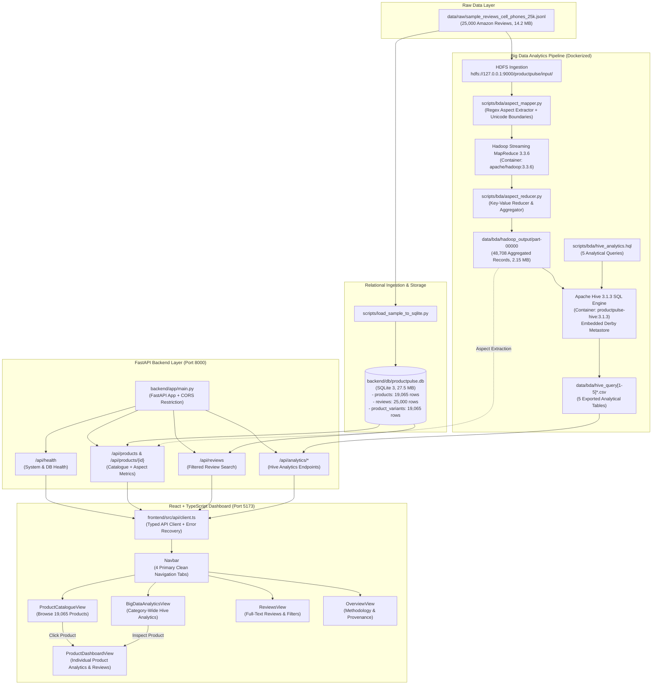

# ProductPulse — Technical Architecture & Data Flow

This document details the architectural design, data flow pipelines, storage schemas, API contracts, and component interactions of the ProductPulse platform.

---

## 1. End-to-End System Architecture

The following Mermaid diagram illustrates the actual components and data flow implemented in the ProductPulse codebase:



---

## 2. Storage & Database Design (`backend/db/productpulse.db`)

The relational database is implemented in **SQLite 3** (`27,574,272 bytes`), enforcing relational constraints, foreign keys (`PRAGMA foreign_keys = ON`), and deterministic indexing.

### Schema Specifications

```sql
-- 1. Products Table (19,065 records)
CREATE TABLE products (
    parent_asin TEXT PRIMARY KEY,
    title TEXT NULL,
    brand TEXT NULL,
    price REAL NULL,
    main_category TEXT NOT NULL,
    has_metadata INTEGER NOT NULL DEFAULT 0,
    created_at TEXT NOT NULL DEFAULT (datetime('now', 'utc'))
);

-- 2. Reviews Table (25,000 records)
CREATE TABLE reviews (
    review_id TEXT PRIMARY KEY,
    parent_asin TEXT NOT NULL,
    asin TEXT NOT NULL,
    user_id TEXT NOT NULL,
    rating REAL NOT NULL CHECK (rating >= 1.0 AND rating <= 5.0),
    raw_title TEXT NULL,
    raw_text TEXT NULL,
    review_timestamp_utc TEXT NOT NULL,
    review_epoch_seconds INTEGER NOT NULL,
    helpful_vote INTEGER NOT NULL DEFAULT 0,
    verified_purchase INTEGER NOT NULL DEFAULT 0,
    has_images INTEGER NOT NULL DEFAULT 0,
    is_blank_text INTEGER NOT NULL DEFAULT 0,
    occurrence_index INTEGER NOT NULL DEFAULT 0,
    created_at TEXT NOT NULL DEFAULT (datetime('now', 'utc')),
    FOREIGN KEY (parent_asin) REFERENCES products(parent_asin) ON DELETE RESTRICT
);

-- 3. Product Variants Table (19,065 records)
CREATE TABLE product_variants (
    parent_asin TEXT NOT NULL,
    asin TEXT NOT NULL,
    PRIMARY KEY (parent_asin, asin),
    FOREIGN KEY (parent_asin) REFERENCES products(parent_asin) ON DELETE CASCADE
);

-- Performance and Deterministic Ordering Indexes
CREATE INDEX idx_reviews_parent_asin ON reviews(parent_asin);
CREATE INDEX idx_reviews_rating ON reviews(rating);
CREATE INDEX idx_reviews_verified_purchase ON reviews(verified_purchase);
CREATE INDEX idx_reviews_timestamp ON reviews(review_timestamp_utc DESC);
CREATE INDEX idx_products_metadata ON products(has_metadata);
```

### Relational Properties
- **Total Reviews**: Exactly `25,000`.
- **Unique Products**: Exactly `19,065` distinct parent ASINs.
- **Database Integrity**: Verified via `PRAGMA integrity_check` (`ok`) and `PRAGMA foreign_key_check` (`[]`).

---

## 3. Distributed Big Data Analytics Architecture (Hadoop & Hive)

The batch analytics subsystem operates on genuine Apache Big Data tools inside Docker containers:

### A. Hadoop Streaming MapReduce 3.3.6
- **Input Corpus**: `data/raw/sample_reviews_cell_phones_25k.jsonl` (25,000 records).
- **Mapper (`scripts/bda/aspect_mapper.py`)**:
  - Compiles Unicode word-boundary regular expressions (`re.UNICODE`) for the six locked aspects.
  - Normalizes text and eliminates false-positive word boundaries on accented characters.
  - Emits key-value pairs per distinct aspect in each review:
    `{parent_asin}\t{aspect}\t{rating}\t{helpful_vote}\t1`
  - Emits product baseline metadata:
    `{parent_asin}\t__ALL_REVIEWS__\t{rating}\t{helpful_vote}\t1`
  - Emits non-aspect baseline if no keywords matched:
    `{parent_asin}\t__NO_ASPECT__\t{rating}\t{helpful_vote}\t1`
- **Reducer (`scripts/bda/aspect_reducer.py`)**:
  - Performs streaming aggregation across matching keys.
  - Aggregates review count, sum of ratings, sum of helpful votes, and rating tiers (`1-2★`, `3★`, `4-5★`).
  - Emits tab-separated records to `part-00000` (48,708 aggregate rows).

### B. Apache Hive 3.1.3 Analytical Engine
- **Metastore**: Isolated embedded Derby metastore schema initialized at `/opt/hadoop/metastore_db`.
- **External Table**: `productpulse_bda.product_aspect_metrics` directly mapped over `part-00000`:

```sql
CREATE EXTERNAL TABLE IF NOT EXISTS productpulse_bda.product_aspect_metrics (
    parent_asin STRING,
    aspect STRING,
    review_count INT,
    avg_rating DOUBLE,
    total_helpful_votes INT,
    low_rating_count INT,
    med_rating_count INT,
    high_rating_count INT
)
ROW FORMAT DELIMITED
FIELDS TERMINATED BY '\t'
STORED AS TEXTFILE
LOCATION '/productpulse/output';
```

- **Query Suite (`scripts/bda/hive_analytics.hql`)**:
  1. **Query 1 (Aspect Volumes)**: Total review volume, review-weighted average star rating, and cumulative helpful votes per aspect.
  2. **Query 2 (Top Products by Aspect)**: Products with the highest discussion volume for each aspect.
  3. **Query 3 (Aspect Defect / Pain Points)**: Lowest-rated product aspects (threshold: minimum 5 aspect reviews) to isolate potential customer friction points.
  4. **Query 4 (Rating Band Distributions)**: Proportion of 1–2★, 3★, and 4–5★ customer ratings per aspect.
  5. **Query 5 (Aspect Review Penetration)**: True penetration rate: `(reviews_mentioning_aspect / total_product_reviews) * 100%`, bounded strictly between 0.0% and 100.0%.

---

## 4. Backend API Design (`backend/app/`)

Implemented in **FastAPI** with **Pydantic v2** validation and strictly typed contracts:

| Route | Method | Description | Data Source |
|---|---|---|---|
| `/api/health` | `GET` | Health check, category lock (`Cell_Phones_and_Accessories`), DB connection. | SQLite PRAGMA check |
| `/api/products` | `GET` | Paginated product catalogue with deterministic ordering (`review_count DESC, parent_asin ASC`). | SQLite `products` + `reviews` |
| `/api/products/{parent_asin}` | `GET` | Detailed product metrics, 1★–5★ histogram, helpful votes, and genuine Hadoop aspect aggregates. | SQLite + `data/bda/hadoop_output/part-00000` |
| `/api/reviews` | `GET` | Paginated customer reviews with filters: `parent_asin`, `asin`, `rating`, `verified_purchase`. | SQLite `reviews` table |
| `/api/analytics/overview` | `GET` | High-level BDA summary KPIs (25k reviews, 4.1655★ corpus avg, 19,065 products). | `hive_query1_aspect_volumes.csv` |
| `/api/analytics/aspect-volumes` | `GET` | Discussion volumes and weighted ratings across 6 aspects (Query 1). | `hive_query1_aspect_volumes.csv` |
| `/api/analytics/top-products` | `GET` | Top products ranked by aspect discussion volume (Query 2). | `hive_query2_top_products.csv` |
| `/api/analytics/pain-points` | `GET` | Lowest-rated product aspects with $\ge 5$ reviews (Query 3). | `hive_query3_aspect_ratings.csv` |
| `/api/analytics/rating-bands` | `GET` | Aspect rating distribution across Low (1-2★), Med (3★), High (4-5★) (Query 4). | `hive_query4_rating_bands.csv` |
| `/api/analytics/aspect-penetration` | `GET` | Review penetration percentage per product and aspect (Query 5). | `hive_query5_aspect_cooccurrence.csv` |

---

## 5. Frontend Architecture (`frontend/src/`)

Built with **React 18 + TypeScript + Vite + Tailwind CSS**:

### Component Breakdown
1. **`Navbar.tsx`**: Clean 4-tab top navigation: `Products`, `Review Analytics`, `Customer Reviews`, and `About & Methodology`.
2. **`ProductCatalogueView.tsx`**:
   - Renders 19,065 catalogue items with pagination (`limit=20`).
   - Honest fallback label: `"Product name unavailable"` with sub-label explaining metadata provenance.
   - Distinct canonical ASIN badge (`ASIN: B01415QHYW`).
   - Clicking a product or "Dashboard" opens `ProductDashboardView`.
3. **`ProductDashboardView.tsx`**:
   - **Section A**: Overview & KPIs (Total Reviews, Customer Avg Star Rating, Helpful Votes, Verified Purchase %, Variant Child ASINs).
   - **Section B**: Star Rating Distribution (1★ to 5★ histogram with percentage bars and earliest/latest review dates).
   - **Section C**: Aspect Analytics (MapReduce extractions across 6 aspects with sentiment breakdown bars).
   - **Section D**: Customer Reviews (Integrated review feed for that ASIN with pagination).
   - Top button: `← Back to Products Catalogue`.
4. **`BigDataAnalyticsView.tsx`**:
   - Category-level analytics exploring 5 Hive query outputs.
   - 5 KPI summary cards.
   - Interactive filtering by aspect and ASIN search.
   - One-click navigation from any product table row to its individual dashboard.
5. **`ReviewsView.tsx`**:
   - Full-text review exploration with dynamic filtering (parent ASIN, variant SKU, star rating, verified purchase).
6. **`api/client.ts`**:
   - Type-safe fetch client with request sequence tracking (`activeRequestIdRef`) to prevent stale out-of-order async response leakage.

---

## 6. NLP Baseline Service (`backend/app/nlp/`)

- **Domain Aspect Lexicons**: Deterministic regex dictionaries compiled with word boundaries for the 6 locked aspects.
- **Aspect-Conditional Polarity Rules**: Evaluates sentiment in the syntactic context of detected aspect spans:
  - Positive modifiers: *excellent, great, durable, long-lasting, clear, crisp, fast, smooth, flawless, love*.
  - Negative modifiers: *terrible, poor, broken, fragile, drained, laggy, slow, blurry, distorted, defect*.
- **Evaluation Framework (`scripts/evaluate_nlp_baseline.py`)**:
  - Held-out evaluation on canonical validation partitions.
  - Evaluates rule verification agreement on Sample A (Task 1: Aspect Detection) and Sample B (Task 2: Aspect Sentiment).
